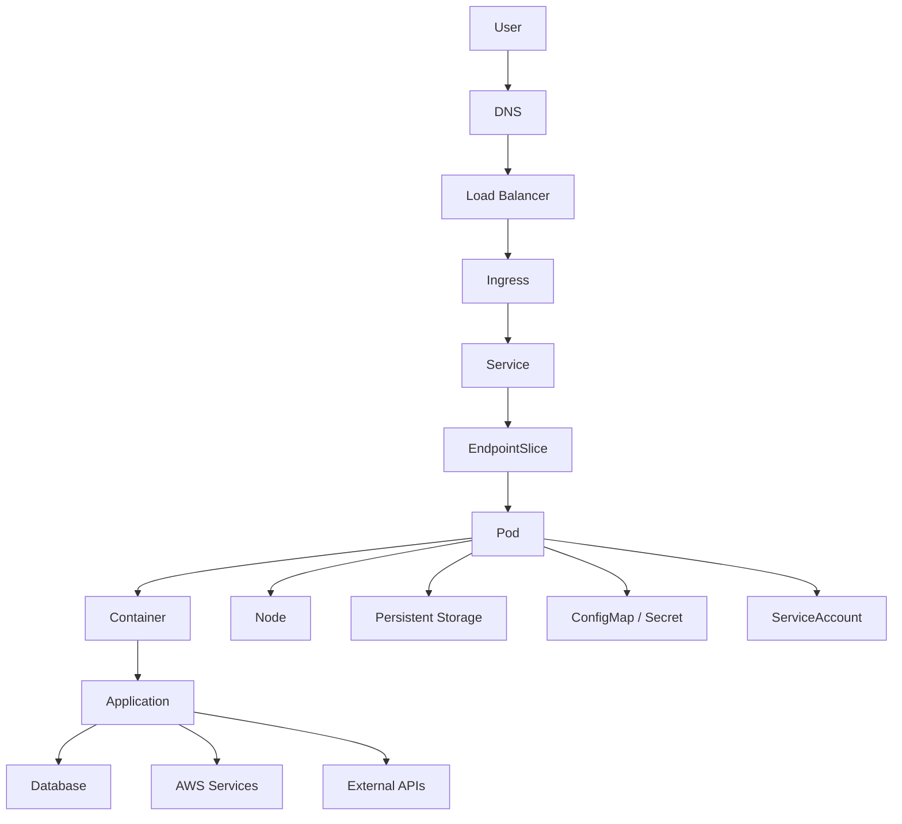
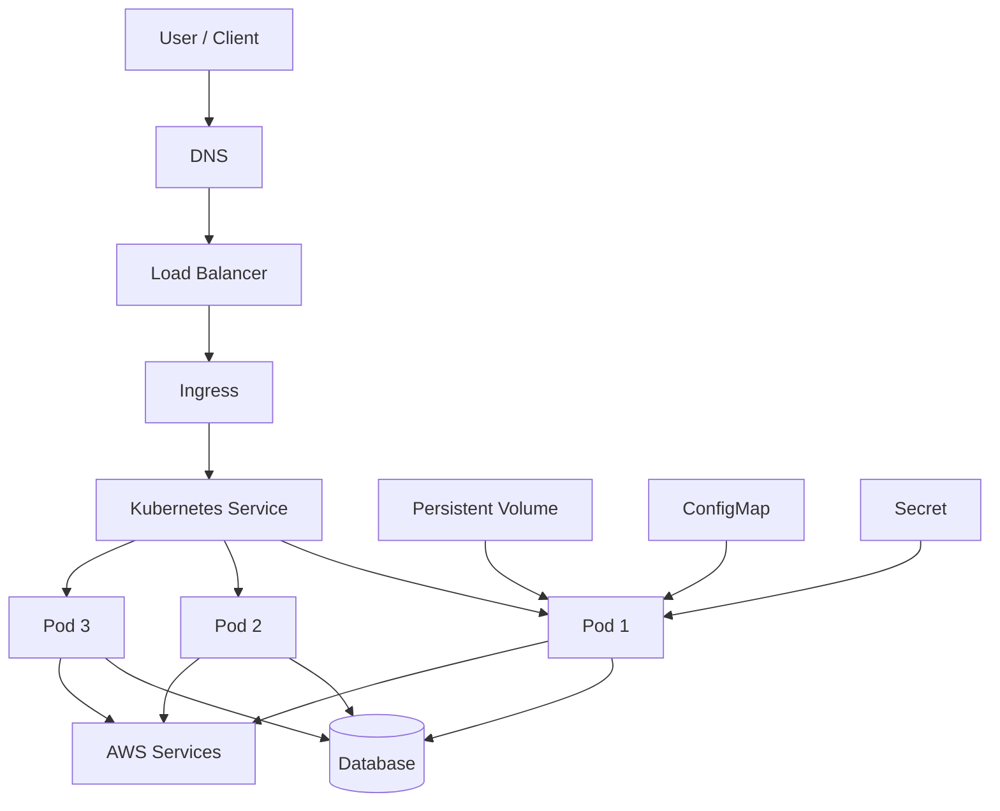
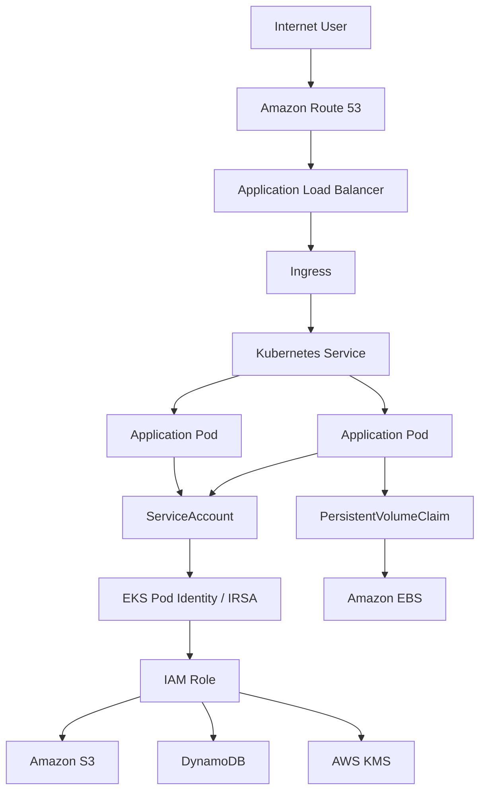
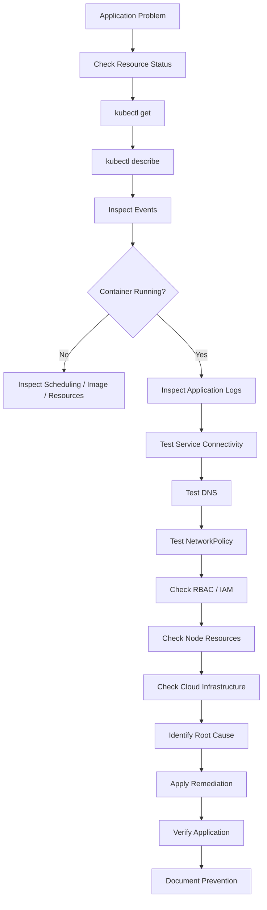

# ☸️ Kubernetes Troubleshooting Labs

A hands-on Kubernetes troubleshooting repository covering **40 common real-world Kubernetes, Cloud Engineering, AWS EKS, networking, storage, scaling, security, and application reliability problems**.

The purpose of this repository is not only to deploy Kubernetes applications, but to understand how to **detect problems, investigate symptoms, identify root causes, apply remediation, and verify that the issue has been resolved**.

This repository focuses on the troubleshooting skills commonly needed by:

- Cloud Engineers
- Cloud Security Engineers
- DevOps Engineers
- Platform Engineers
- Site Reliability Engineers
- Infrastructure Engineers
- Kubernetes Administrators

---

# 📌 Repository Goal

Running an application in Kubernetes is only the beginning.

In production, engineers commonly face problems such as:

```text
Pod stuck in Pending
CrashLoopBackOff
ImagePullBackOff
Service not reaching Pods
DNS failure
RBAC permission errors
EKS IAM AccessDenied
NetworkPolicy blocking traffic
OOMKilled
Node NotReady
PVC Pending
Ingress 404
LoadBalancer Pending
HPA not scaling
Application unavailable from the internet
```

The goal of this repository is to reproduce these failures intentionally and troubleshoot them using a structured engineering process.

The workflow used throughout the labs is:

```text
Problem
   ↓
Observe Symptoms
   ↓
Check Kubernetes Resource
   ↓
Inspect Events
   ↓
Inspect Logs
   ↓
Test Networking
   ↓
Check Permissions
   ↓
Check Resource Usage
   ↓
Check Cloud Infrastructure
   ↓
Identify Root Cause
   ↓
Apply Remediation
   ↓
Verify the Fix
```

---

# 🧠 Core Troubleshooting Philosophy

The most important Kubernetes troubleshooting skill is not memorizing commands.

It is understanding:

> **Which layer of the system is failing?**

A Kubernetes application can fail at many different layers.



Instead of immediately changing configurations, troubleshooting should follow the request path and determine where communication stops.

---

# 🏗️ Kubernetes Troubleshooting Architecture

Most scenarios in this repository are based on an architecture similar to:



A failure anywhere in this flow can cause an application outage.

---

# ☁️ AWS EKS Troubleshooting Architecture

Several advanced labs focus specifically on Amazon EKS.



This allows troubleshooting across both:

```text
Kubernetes Layer
+
AWS Infrastructure Layer
```

---

# 🗂️ Repository Structure

```text
kubernetes-troubleshooting-labs/
│
├── README.md
│
├── 01-pod-pending/
├── 02-crashloopbackoff/
├── 03-imagepullbackoff/
├── 04-errimagepull/
├── 05-pod-running-app-failing/
├── 06-service-cannot-reach-pods/
├── 07-wrong-target-port/
├── 08-dns-resolution-failure/
├── 09-wrong-namespace/
├── 10-pods-not-visible/
├── 11-wrong-kubernetes-context/
├── 12-kubectl-unauthorized/
├── 13-rbac-forbidden/
├── 14-eks-aws-access-denied/
├── 15-networkpolicy-blocking-traffic/
├── 16-oomkilled/
├── 17-cpu-throttling/
├── 18-node-notready/
├── 19-disk-pressure/
├── 20-memory-pressure/
├── 21-pod-eviction/
├── 22-pvc-pending/
├── 23-volume-mount-error/
├── 24-readiness-probe-failure/
├── 25-liveness-probe-restart-loop/
├── 26-deployment-rollout-failure/
├── 27-unavailable-deployment-replicas/
├── 28-ingress-404/
├── 29-loadbalancer-pending/
├── 30-configmap-not-updated/
├── 31-secret-not-updated/
├── 32-kubectl-exec-failure/
├── 33-database-connectivity-failure/
├── 34-internal-app-working-external-failing/
├── 35-invalid-kubernetes-yaml/
├── 36-nodeselector-scheduling-failure/
├── 37-taint-toleration-failure/
├── 38-hpa-not-scaling/
├── 39-pod-restarting/
└── 40-end-to-end-troubleshooting/
```

---

# 🧪 Lab Format

Every troubleshooting lab follows approximately the same structure.

```text
lab-name/
│
├── README.md
├── broken.yaml
├── fixed.yaml
└── optional-supporting-files/
```

Each lab README contains:

```text
Problem Description

Architecture

Expected Behavior

Failure Symptoms

Broken Configuration

How to Reproduce

Initial Investigation

Troubleshooting Commands

Events Analysis

Logs Analysis

Networking Analysis

Root Cause

Remediation

Fixed Configuration

Verification

Prevention

Cloud Engineering Relevance

Cloud Security Relevance

Interview Takeaways
```

---

# 🔎 Troubleshooting Workflow

The following workflow is used throughout the repository.



---

# 🛠️ Essential Troubleshooting Commands

These commands are repeatedly used throughout the labs.

## Cluster Information

```bash
kubectl cluster-info
```

```bash
kubectl get nodes
```

```bash
kubectl get namespaces
```

---

## Pod Investigation

```bash
kubectl get pods
```

```bash
kubectl get pods -A
```

```bash
kubectl get pods -o wide
```

```bash
kubectl describe pod <pod-name>
```

---

## Logs

```bash
kubectl logs <pod-name>
```

Previous container:

```bash
kubectl logs <pod-name> --previous
```

Follow logs:

```bash
kubectl logs -f <pod-name>
```

---

## Events

```bash
kubectl get events
```

Sorted:

```bash
kubectl get events \
  --sort-by=.metadata.creationTimestamp
```

---

## Deployments

```bash
kubectl get deployments
```

```bash
kubectl describe deployment <deployment-name>
```

```bash
kubectl rollout status deployment/<deployment-name>
```

```bash
kubectl rollout history deployment/<deployment-name>
```

Rollback:

```bash
kubectl rollout undo deployment/<deployment-name>
```

---

## Services

```bash
kubectl get svc
```

```bash
kubectl describe svc <service-name>
```

```bash
kubectl get endpoints
```

```bash
kubectl get endpointslices
```

---

## Networking

```bash
kubectl exec -it <pod> -- /bin/sh
```

DNS test:

```bash
nslookup <service-name>
```

HTTP test:

```bash
curl http://<service-name>:<port>
```

Port test:

```bash
nc -zv <host> <port>
```

---

## Resource Usage

```bash
kubectl top pods
```

```bash
kubectl top nodes
```

---

## RBAC

```bash
kubectl auth can-i get pods
```

```bash
kubectl auth can-i delete pods
```

```bash
kubectl auth can-i create deployments \
  -n production
```

---

## Kubernetes Context

```bash
kubectl config current-context
```

```bash
kubectl config get-contexts
```

---

# 🚨 Troubleshooting Labs

---

# 01 — Pod Stuck in Pending

## Problem

A Kubernetes Pod remains:

```text
Pending
```

and never reaches:

```text
Running
```

## Common Root Causes

- Insufficient CPU
- Insufficient memory
- NodeSelector
